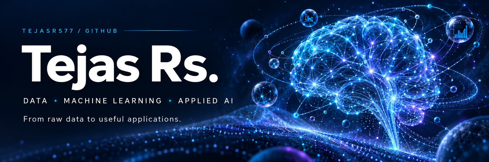

# Hey there, I'm Tejas Rs 👋

### AI/ML Engineer in the Making | Applied AI • Machine Learning • Data Engineering

Building intelligent systems that connect data, machine learning, and real-world applications.

**Python · Machine Learning · Deep Learning · RAG · Computer Vision · SQL · FastAPI**

 

  

---

## 👨‍💻 About Me

I'm **Tejas Rs**, an Artificial Intelligence & Machine Learning engineering student passionate about developing practical, end-to-end intelligent applications.

My interests span **Applied AI, Machine Learning, Computer Vision, Retrieval-Augmented Generation, and Data Engineering**.

I enjoy working across the complete development lifecycle — from preparing datasets and developing models to designing APIs, building interfaces, evaluating performance, and exploring deployment.

- 🎓 Pursuing **B.E. in Artificial Intelligence & Machine Learning**
- 🔭 Building AI/ML and data-driven applications
- 🧠 Exploring **Deep Learning, RAG, Computer Vision, and MLOps**
- ⚙️ Working with **Python, SQL, FastAPI, PostgreSQL, and Docker**
- 📊 Interested in **financial analytics, healthcare AI, and intelligent automation**
- 💼 Open to **AI/ML, Data Science, Applied AI, and Data Engineering** opportunities

---

## ⚡ What I Build

**Machine Learning** → **Intelligent APIs** → **Data Pipelines** → **RAG Applications** → **Computer Vision** → **Analytics**

Transforming raw data into intelligent, practical applications.

---

## 🚀 Featured Projects

### 🏥 EHR Insight & Clinical Validator

**Privacy-Aware Healthcare RAG Application**

An educational healthcare AI application designed to support patient-scoped retrieval and conversational exploration of historical clinical records.

**Key Highlights**

- Developed a clinical RAG pipeline with patient-scoped semantic retrieval.
- Integrated clinical embeddings with PostgreSQL and pgvector for similarity search.
- Implemented PII detection and redaction using Microsoft Presidio.
- Added conversational request controls using NVIDIA NeMo Guardrails.
- Built a FastAPI backend with a Streamlit interface.
- Containerized the application using Docker and documented an AWS deployment architecture.

**Tech Stack:** `Python` `FastAPI` `Streamlit` `PostgreSQL` `pgvector` `RAG` `Microsoft Presidio` `NeMo Guardrails` `Docker`

---

### ✈️ AeroGuard AI

**Aircraft Engine Predictive Maintenance & Reliability Analytics**

A predictive maintenance project exploring aircraft-engine degradation, remaining useful life estimation, and AI-assisted maintenance insights.

**Key Highlights**

- Uses the NASA C-MAPSS turbofan engine degradation dataset.
- Explores multivariate sensor readings and operating conditions.
- Models degradation patterns for remaining useful life estimation.
- Combines predictive analytics with an AI-assisted maintenance interpretation workflow.
- Focuses on model evaluation, reliability analysis, and explainable maintenance decisions.

**Focus Areas:** `Predictive Maintenance` `Machine Learning` `Remaining Useful Life` `Reliability Analytics` `Applied AI`

---

### 💳 FinRecon AI

**Intelligent Financial Reconciliation & Exception Investigation**

A financial reconciliation platform designed to identify transaction discrepancies, investigate exceptions, and support evidence-based financial decisions.

**Key Highlights**

- Matches payments, settlements, refunds, and bank transaction records.
- Detects reconciliation anomalies such as missing settlements, duplicate credits, fee mismatches, and incorrect references.
- Combines deterministic matching with AI-assisted exception investigation.
- Uses 5,000+ synthetic financial records with controlled anomalies for evaluation.
- Provides a control-tower dashboard for reviewing reconciliation results and exceptions.
- Explores confidence-based decision workflows and human review for uncertain matches.

**Focus Areas:** `Financial Reconciliation` `Anomaly Detection` `Applied AI` `Financial Analytics`

---

### 📊 Finance ETL & Analytics

**Incremental Financial Data Pipeline & Analytics Platform**

A production-style data engineering project that transforms raw financial transaction records into structured datasets for analytics and reporting.

**Key Highlights**

- Processes approximately **200,000 synthetic financial transactions**.
- Implements Python and Pandas-based ingestion, validation, and transformation.
- Uses a MySQL star schema with **Slowly Changing Dimension Type 2 (SCD-2)** customer history.
- Implements incremental loading with watermarks, upserts, checksums, and batch inserts.
- Uses transactional rollback and analytical indexing to improve reliability.
- Includes **49 automated pytest tests**.
- Provides FastAPI services and a React-based analytics interface.

**Tech Stack:** `Python` `Pandas` `MySQL` `SQLAlchemy` `Pytest` `FastAPI` `React`

---

### 👁️ VisionGuard AI

**Computer Vision, Visual Geometry & Inference Optimization**

A modular computer vision project exploring deep learning-based perception, object tracking, classical computer vision, and motion estimation.

**Key Highlights**

- Implemented YOLOv8 object detection for image and video processing.
- Integrated ByteTrack to assign consistent object identities across video frames.
- Explored instance segmentation and human pose estimation.
- Exported YOLOv8n to ONNX and benchmarked inference against PyTorch on an AMD Ryzen 5 CPU.
- Reduced average model inference latency from **168.52 ms to 94.56 ms**, approximately a **1.78× speedup** in the measured benchmark.
- Implemented experiments involving camera calibration, ORB feature matching, essential matrices, relative camera pose, and triangulation.
- Explored synthetic visual odometry for camera trajectory estimation.
- Implemented a separate Kalman filtering experiment for noisy 2D motion measurements.

**Note:** Visual odometry and Kalman filtering evaluations use synthetic data and are experimental modules rather than a fully integrated real-world system.

**Tech Stack:** `Python` `OpenCV` `YOLOv8` `ByteTrack` `PyTorch` `ONNX Runtime` `NumPy`

---

## 🛠️ Technical Toolkit

### 🐍 Programming & Data Analysis

  

 

### 🧠 Machine Learning & Computer Vision

  

 

### 🔎 Generative AI & Retrieval Systems

 

### 🗄️ Databases & Data Engineering

  

 

### ⚡ Backend & Application Development

  

 

### 🚀 Development, Testing & Deployment

  

---

## 📈 GitHub Analytics

<i>A snapshot of my development activity and contributions.</i>

  

  

---

## 🐍 Contribution Journey

<i>Every contribution is another step in the learning process.</i>

  

<picture>
  <source
    media="(prefers-color-scheme: dark)"
    srcset="https://raw.githubusercontent.com/tejasrs77/tejasrs77/output/github-snake-dark.svg"
  >
  <source
    media="(prefers-color-scheme: light)"
    srcset="https://raw.githubusercontent.com/tejasrs77/tejasrs77/output/github-snake.svg"
  >
  
</picture>

---

## 🤝 Let's Connect

### Interested in building something with AI or data?

I'm open to **AI/ML Engineering, Applied AI, Data Science, and Data Engineering internships and entry-level opportunities**.

I enjoy collaborating on practical projects, learning new technologies, and solving challenging engineering problems.

 

  

### Thanks for visiting! ⭐

Building practical AI systems, one project at a time.

